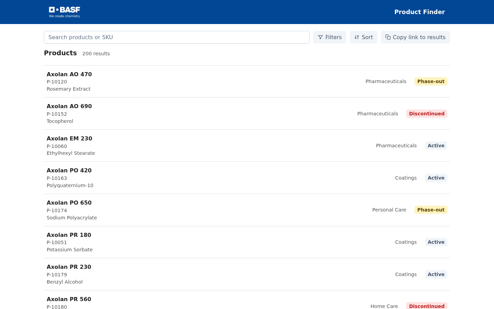
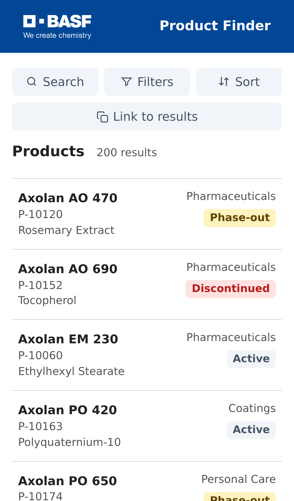

# Product Finder take-home assignment

Original brief: [ASSIGNMENT.md](ASSIGNMENT.md).

- **Live preview:** [Product Finder on Railway](https://app-production-323f.up.railway.app)
- **Video overview:** https://www.loom.com/share/5fc55e5ff7e945439bbfb0f472926bc1

|                                                   Desktop product finder                                                    |                                                   Mobile product finder                                                   |
| :-------------------------------------------------------------------------------------------------------------------------: | :-----------------------------------------------------------------------------------------------------------------------: |
|  |  |

- Browse, search and filter the catalogue, and view and share product details.
- Read and submit product reviews, including on unavailable products.
- Run the application locally or with Docker; Jest, PostgreSQL integration and Playwright suites cover the delivered slices.

---

# How to Run and Manage the App

Requires Docker Compose, Node.js 22.22.3 and npm 10. Run from the repository root:

```sh
npm ci
docker compose up -d --wait db
npm run db:migrate
npm run db:seed
docker compose up --build --wait
```

Open <http://localhost:8180>. Stop with `docker compose down`; the database volume persists. To re-import another complete catalogue, run `npm run db:seed -- /absolute/path/to/products.csv`.

PrimeNG 22 requires a Community key. After `npm ci`, add it to `apps/web/src/primeng-license.local.ts` before building; without it, the app runs with a license notice. See the [installation guide](https://primeng.dev/installation).

For the Railway demo, set `PRIMENG_LICENSE_KEY` on the app service. The API supplies it to the browser at startup, so it is not committed to the repository and is visible to visitors of the application. An unavailable or empty runtime setting falls back to the locally configured key.

For local development, run `npm run dev` after migrating and seeding, then open <http://localhost:4200>.

### Testing Web Share locally (HTTPS)

The Web Share API requires a secure context. To test native share behavior locally over HTTPS:

```sh
npm run dev:ssl
```

Then open <https://localhost:4200> (accept the self-signed certificate in your browser).

## Tests

```sh
npm run check              # lint, formatting, unit tests and builds
npm run test:integration   # isolated PostgreSQL tests
npx playwright install chromium
npm run test:e2e           # isolated browser tests
```

See [DECISIONS.md](DECISIONS.md) and [docs/README.md](docs/README.md) for supporting information.
